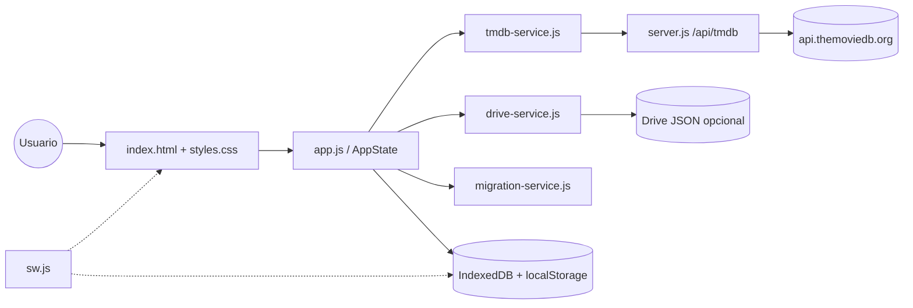
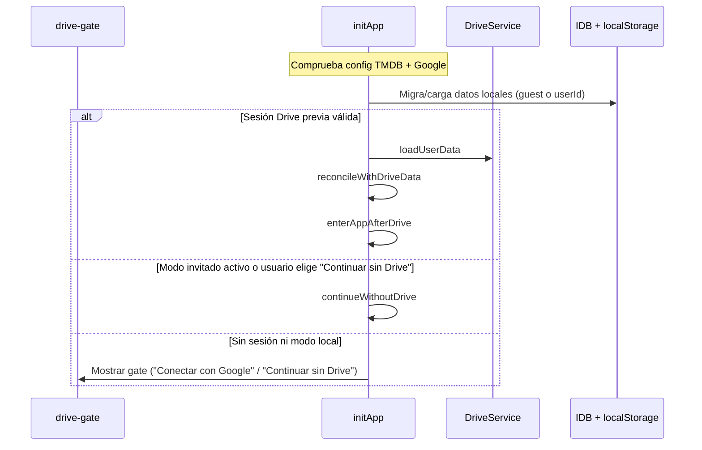

# 01 — Visión y arquitectura

← [Índice](README.md) · Siguiente: [02 Modelo de datos](02-modelo-de-datos.md)

---

## Propósito

SeenIt es una **PWA de seguimiento personal** de series y películas:

- El **catálogo** (títulos, pósteres, episodios, plataformas, tráilers, sagas) viene de **TMDB**, servido mediante un **proxy efímero** en `server.js` para proteger `TMDB_API_KEY` y habilitar la exportación PNG de tarjetas Wrapped.
- La **biblioteca del usuario** (qué has visto, notas, reseñas, listas, selector, preferencias y logros) vive **en el dispositivo** (`IndexedDB` + `localStorage`) y, de forma **opcional**, se sincroniza con el **Google Drive** del propio usuario (`tv_showtime_data.json`).
- **Sin base de datos central de usuarios**: el servidor Node/Express (`server.js`) no almacena bibliotecas, cuentas ni analíticas.

Restricciones que condicionan todo el diseño:

1. Sin BD central → OAuth en cliente con `drive.file` (solo ficheros que crea la app) y modo local sin login (`continueWithoutDrive`).
2. Varios dispositivos / pestañas → hace falta **merge** (LWW + tombstones), no “último save gana a ciegas”.
3. Offline parcial → Service Worker (`sw.js`) cachea el shell y evalúa notificaciones locales en segundo plano usando IndexedDB; los datos de biblioteca no van en Cache API.

---

## Capas

| Capa | Archivos | Responsabilidad |
|------|----------|-----------------|
| Shell | `index.html`, `styles.css`, `manifest.json`, `icons/` | Estructura DOM, chrome sticky, modales, desplegables de Ajustes, PWA |
| App | `app.js` | Estado (`AppState`), vistas, timelines, selector, gamificación, Wrapped, notificaciones, sync |
| TMDB | `tmdb-service.js` | HTTP TMDB (vía proxy o directo), normalización, caché IDB de temporadas |
| Drive | `drive-service.js` | GIS OAuth, token, CRUD del JSON en Drive (`drive.file`) |
| Migración | `migration-service.js` | Importador y exportador universal (SeenIt, SeriesGuide, Trakt, Letterboxd, IMDb, TV Time, CSV) |
| Servidor | `server.js`, `package.json`, `vercel.json` | Estáticos, `/config.js` dinámico, `/api/tmdb/*` (caché LRU), `/api/tmdb-image` |
| Config | `.env` / variables de entorno (o `config.js` local) | Claves; plantillas en `.env.example` y `config.example.js` |

---

## Orden de scripts

En `index.html` (final del body), el orden importa:

1. `config.js` (generado por `server.js` en `/config.js` o fichero estático local) — define `CONFIG_*`
2. `tmdb-service.js` — expone `window.TMDBService` y helpers
3. `drive-service.js` — expone `window.DriveService`
4. `app.js` — usa los anteriores y arranca `initApp`
5. `migration-service.js` — se engancha sobre `AppState` y expone `window.SeenItMigration` y funciones globales de los modales de importación/exportación
6. Registro del Service Worker (`sw.js`) y banner de actualización (`#sw-update-banner`)

Si cargas `app.js` antes de los servicios, fallarán las comprobaciones de config y las llamadas globales.

---

## Arranque (`initApp`)

Flujo simplificado:

Puntos clave en `app.js`:

- `setDriveGateVisible` — oculta `#app` hasta elegir conexión con Drive o modo local (`continueWithoutDrive`).
- Biblioteca **por usuario**: clave `seenit_data__${userId}` (o `seenit_data__guest` en modo local; migración desde legacy `seenit_data`).
- Espejo en IndexedDB (`seenit_local_db`) para mayor capacidad y durabilidad frente a límites de `localStorage`.
- Tras merge, `saveLocalData` + push a Drive según resultado (`remote` / `merged` / `local-upload`).

Detalle: [03 Persistencia y sync](03-persistencia-y-sync.md), [05 Drive OAuth](05-drive-oauth.md).

---

## `AppState` (mapa mental)

Objeto único en memoria (`app.js`). No es un framework: mutas arrays/campos y re-renderizas vistas concretas.

| Grupo | Campos principales | Uso |
|-------|--------------------|-----|
| Biblioteca | `movies`, `shows`, `lists`, `selectorItems` | Fuente de verdad en sesión |
| Tombstones | `deletedIds`, `deletedListIds`, `deletedSelectorKeys` | Borrados que deben ganar en merge |
| Navegación | `currentTab`, `currentSubTab`, `currentMoviesSubTab`, `currentProfileTab`, `currentSettingsSubTab` | `series` / `movies` / `explore` / `profile` / `settings` |
| Filtros perfil | `profile*Filter`, `profile*Search`, `profile*Platform`, `profile*Sort` | Biblioteca en Perfil |
| Filtros películas | `moviesPendingSearch`, `moviesPendingSort`, `moviesPendingGenres`, `moviesPendingPlatforms`, `moviesPendingMaxRuntime`, `moviesPendingMySubsOnly`, `moviesPendingFiltersOpen` | Lista pendiente películas |
| Selector | `selectorFilter`, `selectorWinnerKey`, `selectorIsSpinning`, `selectorSuggestionsOpen`, `selectorSearchQuery`, `selectorSearchResults` | Modal `¿Qué vemos?` |
| Detalle | `selectedItem`, `selectedEpisode`, `selectedPerson`, `detailCriticaEditing`, `activeTrailerKey`, `revealedSpoilerEpisodeKeys` | Modales ficha / episodio / persona |
| Preferencias & Gamif | `preferences`, `gamification`, `achievements*`, `rewardsExpanded`, `tickets*`, `wrappedExpanded`, `collectibleModalState` | Ajustes, logros, temas, sagas, Wrapped |
| Drive | `isDriveConnected`, `isSyncing`, `syncDirty`, `driveUserId`, `driveLoadOk` | Sync |
| Timeline & Cal | `timelineHistoryVisible`, `timelineHistoryCache`, `timelinePendingCache`, `timelineUpcomingCache`, `upcomingSeriesCal`, `upcomingMoviesCal` | Listas series y minicalendarios |

Constantes relacionadas:

- `TIMELINE_FETCH_CONCURRENCY = 8` (`UPCOMING_FETCH_CONCURRENCY = 12`)
- `TIMELINE_CACHE_FRESH_MS = 3 * 60 * 1000`
- `SHOW_META_TTL_MS = 12 h`

---

## Patrón de UI

1. HTML define contenedores (`#pending-list-container`, `#settings-preferences-container`, modales y desplegables `
`).
2. Funciones `render*` generan HTML (strings) e `innerHTML`.
3. Acciones del usuario: atributos `onclick="..."` → funciones en `window` (ver [14](14-api-global-window.md)).
4. Cambios de datos: mutar ítem → `touchUpdatedAt` / `saveLocalData` → `syncToDrive` (debounce 2 s, o flush inmediato en casos críticos).

---

## Si quieres cambiar X, toca Y

| Quieres… | Empieza en… |
|----------|-------------|
| Nueva pestaña principal | `index.html` (nav) + `switchTab` + `styles.css` |
| Nuevo campo en serie/película/preferencias | [02](02-modelo-de-datos.md) + `normalizeStored*` / `normalizePreferences` + merge + UI |
| Nueva llamada TMDB | `ALLOWED_TMDB_PATH_PATTERNS` en `server.js` + `tmdb-service.js` + export en `window` |
| Nuevo importador / exportador | `migration-service.js` (`PLATFORM_DIRECTORY`, `EXPORT_TARGETS`) |
| Comportamiento offline o notificaciones SW | `sw.js` + bump de versión ([12](12-pwa-service-worker.md)) |
