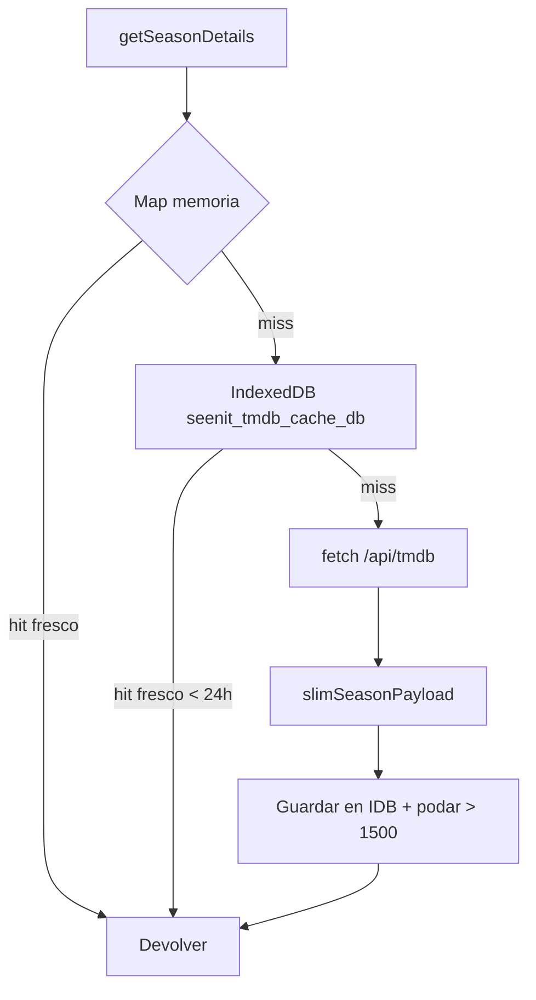

# 04 — TMDB

← [03 Sync](03-persistencia-y-sync.md) · [Índice](README.md) · Siguiente: [05 Drive](05-drive-oauth.md)

---

## Propósito

`tmdb-service.js` gestiona las llamadas a The Movie Database, normaliza respuestas al shape de SeenIt y mantiene cachés en memoria e IndexedDB para proteger cuotas y acelerar timelines.

---

## Proxy en `server.js` vs modo directo

Por defecto, `server.js` sirve `/config.js` con `CONFIG_TMDB_PROXY = true`:

- Las peticiones salen hacia **`/api/tmdb{endpoint}`** dentro del mismo origen; `server.js` valida que el endpoint pertenezca a `ALLOWED_TMDB_PATH_PATTERNS`, filtra `ALLOWED_TMDB_QUERY_PARAMS`, inyecta `TMDB_API_KEY` en servidor y mantiene una caché LRU en memoria (`TMDB_CACHE_MAX_ENTRIES = 600`, dedup *inflight*, TTL 5–30 min).
- Para exportar tarjetas Wrapped con pósters/backdrops externos sin error CORS en `<canvas>`, `server.js` expone **`/api/tmdb-image?path=…&size=…`** (sólo paths de imagen TMDB válidos).
- Si se despliega sin servidor Node usando un `config.js` estático con `CONFIG_TMDB_API_KEY`, `tmdb-service.js` cae automáticamente a llamadas directas a `https://api.themoviedb.org/3`.

---

## Constantes en `tmdb-service.js`

| Constante | Valor / uso |
|-----------|-------------|
| `TMDB_BASE_URL` | `https://api.themoviedb.org/3` |
| `TMDB_IMAGE_BASE_URL` | `https://image.tmdb.org/t/p` |
| `TMDB_IDB_NAME` | `seenit_tmdb_cache_db` (store `season_items`, máx. 1500 ítems) |
| `SEASON_CACHE_TTL_MS` | 24 h |
| `TMDB_MAX_CONCURRENT_REQUESTS` | 6 peticiones simultáneas (cola interna) |
| Región providers | Configurable por usuario (`ES`, `MX`, `AR`, `CO`, `CL`, `US`) |

---

## Endpoints principales

| Función | Endpoint típico | Uso en app |
|---------|-----------------|------------|
| `searchMulti` / `searchMovies` / `searchTV` | `/search/...` | Explorar y buscador del Selector |
| `getTrending` | `/trending/{type}/week` | Escaparate y ranking semanal en Explorar |
| `getMovieDetails` / `getTVDetails` | `/movie/{id}` · `/tv/{id}` | Añadir / ficha (con `credits`, `recommendations`, `videos`, `watch/providers`) |
| `getTVShowMeta` | `/tv/{id}` | Timelines, temporada nueva, `next_episode_to_air` |
| `getSeasonDetails` | `/tv/{id}/season/{n}` | Episodios ordenados, progreso |
| `getCollectionDetails` | `/collection/{id}` | Sagas y entradas de cine vintage |
| `getPersonDetails` / `getPersonCombinedCredits` | `/person/{id}` | Modal de reparto (`#person-modal`) |
| `getWatchProviders` | `/{type}/{id}/watch/providers` | Plataformas por país |
| `findByExternalId` / `find*ByTitleYear` | `/find/{id}` · `/search/...` | Importación en `migration-service.js` |

---

## Caché de temporadas (IDB + memoria)

- `clearSeasonDetailsCache(tvId?)` — invalidar tras cambios o desde Ajustes («Limpiar caché TMDB»).

---

## Watch providers

`getWatchProviders(type, id, country)`:

1. Lee la región configurada en preferencias (`ES` por defecto, fallback a `ES` o primer país disponible).
2. Combina `flatrate`, `free`, `ads`, `rent`, `buy`.
3. La unificación de nombres y chips está en `app.js` (`normalizeProviderName`, `FEATURED_PROVIDERS`).

---

## Si quieres cambiar X, toca Y

| Cambio | Dónde |
|--------|--------|
| Permitir nuevo endpoint TMDB en proxy | `ALLOWED_TMDB_PATH_PATTERNS` en `server.js` |
| Añadir país de plataformas | `PROVIDER_COUNTRIES` en `app.js` |
| TTL caché temporadas | `SEASON_CACHE_TTL_MS` en `tmdb-service.js` |
