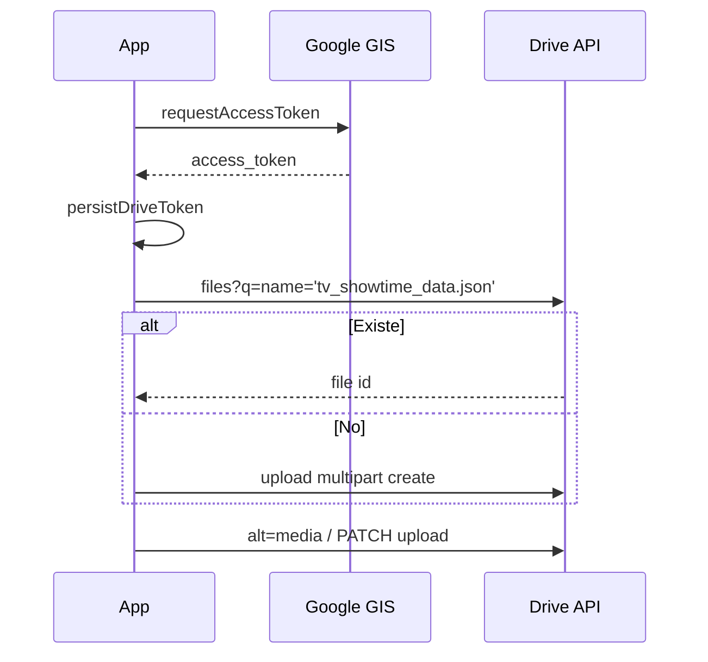

# 05 — Drive OAuth

← [04 TMDB](04-tmdb.md) · [Índice](README.md) · Siguiente: [06 Layout](06-navegacion-y-layout.md)

---

## Propósito

`drive-service.js` gestiona de forma **opcional**:

1. Login con **Google Identity Services** (GIS) — token OAuth en el cliente.
2. Lectura/escritura del JSON de biblioteca en Google Drive del usuario.
3. Renovación silenciosa del token cuando aún es válido.

No usa `gapi.client.init` (problemático con API keys restringidas). Las llamadas son `fetch` a Drive v3 con `Authorization: Bearer`.

Además, SeenIt soporta **modo local sin Drive** (`continueWithoutDrive()`): el usuario puede entrar sin cuenta de Google y almacenar todo en el dispositivo (`localStorage` + `IndexedDB`), conectando Drive más tarde desde Ajustes si quiere sincronizar.

---

## Configuración

- Obligatorio para Drive: `CONFIG_GOOGLE_CLIENT_ID` (OAuth Web Client), inyectado dinámicamente desde `server.js` en `/config.js` a partir de `process.env.GOOGLE_CLIENT_ID` (o fallback de `config.js` local).
- Scope: `https://www.googleapis.com/auth/drive.file` (solo ficheros creados/abiertos por la app).
- Nombre del fichero en Drive: **`tv_showtime_data.json`** (`DATA_FILE_NAME`).
- Header recomendado en servidor (`server.js`): `Cross-Origin-Opener-Policy: same-origin-allow-popups` para que el popup de GIS funcione correctamente.

Orígenes autorizados en Google Cloud deben coincidir con `window.location.origin` (p.ej. `http://localhost:3000`, dominio de Vercel o entorno de producción).

---

## Token

| Pieza | Detalle |
|-------|---------|
| Storage | `seenit_drive_token` → `{ accessToken, expiresAt }` |
| Margen | `TOKEN_REFRESH_MARGIN_MS` = 5 min |
| `restoreAccessToken` | Al init, si el token sigue fresco (o renueva en silencio) |
| `ensureValidAccessToken({ interactive })` | Renueva; `interactive: true` abre popup si hace falta (con fallback a `prompt: 'consent'`) |
| `authenticate` | Login explícito (gate / botón Conectar en Ajustes) |
| `signOut` | Revoca si puede, limpia token, cache de archivo y estado |

---

## Fichero de datos

| Función | Rol |
|---------|-----|
| `findOrCreateDataFile` | Query por nombre + `trashed=false`; si no, crea (`findOrCreatePromise` evita duplicados concurrentes) |
| `createDataFile` | Multipart upload con `{ movies, shows, lists }` vacío |
| `loadUserData` | `GET .../files/{id}?alt=media` |
| `saveUserData` | `PATCH` multipart; exige `movies` y `shows`; soporta `options.keepalive` (≤ 60 KB) al cerrar pestaña |
| `resetDriveDataFileCache` | Olvida `dataFileId` en memoria (tras logout / cambio cuenta) |

`withDriveAuth`: si recibe 401/403, pide token interactivo y reintenta una vez.

---

## Integración con la app

- Gate `#drive-gate`: ofrece **Conectar con Google Drive** (`connectDriveFromGate`) y **Continuar sin cuenta (solo este dispositivo)** (`continueWithoutDrive`, guarda `seenit_guest_mode = '1'`).
- Tras auth: `getUserInfo`, asigna `driveUserId`, carga local por usuario (`seenit_data__<id>` + `seenit_local_db`), `loadUserData`, `reconcileWithDriveData`.
- Si pasa de modo invitado a Drive por primera vez, la biblioteca local se fusiona con Drive mediante LWW.
- En **Ajustes**, estado y botones para conectar, sincronizar (`loadFromDrive`), desconectar (`disconnectDrive`) y borrar datos (`clearAllData`, que también limpia Drive si está conectado).

Detalle de merge y persistencia local: [03](03-persistencia-y-sync.md).

---

## Limitaciones del scope `drive.file`

- La app **no** lista ni lee todo el Drive del usuario.
- Solo accede a `tv_showtime_data.json` creado por la propia app.
- Si el usuario borra `tv_showtime_data.json` en Drive web, el siguiente `findOrCreateDataFile` creará uno nuevo vacío; el respaldo local en IndexedDB/`seenit_data_backup` protege los datos del navegador actual para re-subirlos.

---

## Errores frecuentes

| Síntoma | Causa |
|---------|--------|
| `origin_mismatch` | Origen (`http://localhost:3000` o dominio deploy) no listado en el Client ID |
| Popup bloqueado | Navegador bloquea GIS o falta interacción directa |
| Consent en “Prueba” | Solo test users autorizados en Google Cloud |
| `CONFIG_MISSING` | Sin `GOOGLE_CLIENT_ID` configurado (la app sigue siendo usable en modo local) |
| Sesión caducada | Token expirado sin poder renovar en silencio; permite reconectar desde Ajustes o gate |

---

## Si quieres cambiar X, toca Y

| Cambio | Dónde |
|--------|--------|
| Nombre del JSON en Drive | `DATA_FILE_NAME` en `drive-service.js` (rompe continuidad) |
| Client ID en runtime | `.env` (`GOOGLE_CLIENT_ID`) / `/config.js` en `server.js` |
| Scope más amplio | `SCOPES` + pantalla de consentimiento Google |
| Modo sin Drive por defecto | `initApp` y `continueWithoutDrive` en `app.js` |
