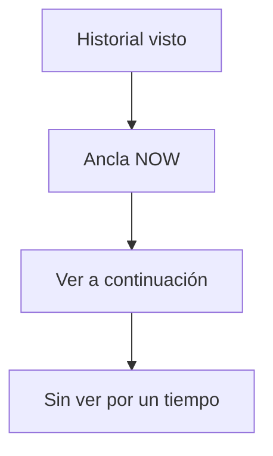

# 07 — Timeline de series

← [06 Layout](06-navegacion-y-layout.md) · [Índice](README.md) · Siguiente: [08 Películas](08-peliculas-y-filtros.md)

---

## Propósito

La pestaña **Series** tiene dos subvistas:

1. **Lista pendiente** — próximo episodio por ver de cada serie en estado `watching`, dividida en *Ver a continuación* y *Sin ver por un tiempo*, más historial hacia arriba.
2. **Próximamente** — episodios con fecha de emisión futura (series no abandonadas) junto a un **mini-calendario semanal interactivo**.

Todo el scroll y el ancla viven en `.tvst-main` ([06](06-navegacion-y-layout.md)).

---

## Lista pendiente: anatomía

Orden visual (de arriba a abajo en el DOM):

1. **Historial** (episodios ya vistos) — parcialmente oculto; se revela al hacer scroll hacia arriba.
2. **Ancla** `data-timeline-anchor="pending-list"` — marca el inicio de “ahora”.
3. **Ver a continuación** — series activas recientes o con `continueBoostAt`.
4. **Sin ver por un tiempo** — resto de series `watching` con episodios pendientes emitidos.

Al entrar en la tab, `timelineHistoryVisible['pending-list'] = 0` y `resetPendingListScroll` posiciona el scroll para que el ancla quede justo bajo el subnav sticky.

---

## Ventana de inactividad configurable (`inactivityDays`)

`isShowInContinueSection(show)` usa `AppState.preferences.inactivityDays` (por defecto **`14`**; valores válidos en `VALID_INACTIVITY_DAYS`: **`7`, `14`, `30`, `60`** días configurables en Ajustes):

1. Si `continueBoostAt` tiene ≤ `inactivityDays` días → *Ver a continuación*.
2. Si no hay actividad de visionado y 0 episodios vistos → *Ver a continuación* (recién empezada).
3. Si la última actividad (`capitulos_vistos_fecha` / helpers) tiene ≤ `inactivityDays` días → *Ver a continuación*.
4. En caso contrario → *Sin ver por un tiempo*.

### `continueBoostAt`

Cuando una serie `completed` detecta **temporada nueva** en TMDB (`refreshCompletedShowsForNewSeasons`):

- Pasa automáticamente a `watching`.
- `continueBoostAt = nowIso()`.
- Muestra toast informativo.
- Entra en *Ver a continuación* aunque aún no hayas marcado episodios nuevos.

---

## Saltar episodios (`capitulos_saltados`) y especiales

- **Episodios saltados:** un episodio incluido en `show.capitulos_saltados` no cuenta como pendiente ni bloquea completar la serie (`toggleEpisodeSkipped`, `toggleSeasonSkipped`).
- **Especiales (Temporada 0):** controlados por `preferences.includeSpecials` (`false` por defecto). Si están desactivados, se excluyen del progreso y del timeline.
- **Episodios anteriores:** `preferences.previousEpisodesRule` (`ask` | `always_mark` | `never`) determina qué ocurre al marcar un episodio posterior con anteriores sin ver.

---

## Build y caché del timeline

| Pieza | Rol |
|-------|-----|
| `buildWatchingPendingEntries` | Para cada show `watching`, calcula el siguiente episodio no visto ni saltado ya emitido |
| `rebuildPendingTimeline` | Separa continue/stale, guarda `timelinePendingCache`, pinta |
| `buildHistoryEntries` | Historial en background → `timelineHistoryCache` |
| `TIMELINE_CACHE_FRESH_MS` | 3 min: si la caché es fresca, pinta inmediato y refresca en background |
| `invalidateTimelineCaches` | Invalida tras toggles, añadir/quitar, saltos o cambios de ajustes |
| `orderedEpisodesCache` | Episodios ordenados por serie en memoria |
| Concurrencia | `TIMELINE_FETCH_CONCURRENCY = 8`, pools a 3 para meta |

`paintPendingTimeline` genera las filas con badges **Nuevo** / **Último** y botones de check rápido.

---

## Ancla y scroll-up de historial

| Función | Qué hace |
|---------|----------|
| `getPendingListContentAboveAnchor` | Altura del contenido por encima del ancla |
| `getTimelineStickyOffset` | Compensa subnav medido |
| `resetPendingListScroll` | `scrollTop = above - stickyOffset`; habilita carga de historial tras rAF |
| `anchorTimelineToNow` / `scrollToNowAnchor` | Re-centra al pulsar el botón NOW |
| `handleTimelineScroll` | Si scroll-up cerca del tope y `__seenitHistoryLoadReady`, incrementa `timelineHistoryVisible` y re-pinta preservando posición |
| `attachPendingAnchorResizeObserver` | Reajusta si el contenedor cambia de altura al hidratar |

Tras marcar un episodio visto: `bumpPendingHistoryAfterWatch` asegura al menos 1 fila de historial visible sin perder el ancla en *Ver a continuación*.

---

## Próximamente y mini-calendario semanal

- Incluye episodios futuros de series en biblioteca (excluyendo `abandoned`).
- **Mini-calendario semanal** (`AppState.upcomingSeriesCal = { weekOffset, selectedDate }`):
  - Navegación por semanas (`shiftUpcomingCalendarWeek('series', delta)`), selección de un día concreto (`selectUpcomingCalendarDate`) o reset (`resetUpcomingCalendar`) y salto rápido desde tarjetas (`jumpToUpcomingCalendarDate`).
  - Los días con estrenos muestran indicador visual y filtran la lista al seleccionarse.
- Cache en `timelineUpcomingCache`.
- También alimenta el calendario interno de notificaciones PWA ([12](12-pwa-service-worker.md)).

---

## Badges de episodio

`getEpisodeBadges`: **Nuevo** (emitido ≤7 días y no visto), **Último** (último emitido de la serie).

---

## Si quieres cambiar X, toca Y

| Cambio | Dónde |
|--------|--------|
| Opciones de días de inactividad | `VALID_INACTIVITY_DAYS` en `app.js` + select `#pref-inactivity-days` en `index.html` |
| Criterio de “siguiente episodio pendiente” | `buildWatchingPendingEntries` + `capitulos_saltados` |
| Mini-calendario semanal | `upcomingSeriesCal` y helpers `*UpcomingCalendar*` en `app.js` |
| Temporada nueva | `refreshCompletedShowsForNewSeasons` + `ensureShowSeasonMeta` |
| TTL cache timeline | `TIMELINE_CACHE_FRESH_MS` |
