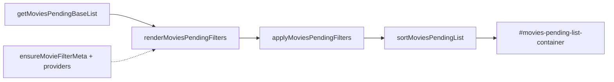

# 08 — Películas y filtros

← [07 Timeline](07-timeline-series.md) · [Índice](README.md) · Siguiente: [09 Perfil](09-perfil-listas-favoritos.md)

---

## Propósito

La pestaña **Películas** tiene dos subvistas:

1. **Lista pendiente** — grid de pósters con barra compacta de búsqueda, ordenación, selector rápido aleatorio (“¿Qué veo?”) y filtros colapsables multi-selección.
2. **Próximamente** — estrenos futuros de películas pendientes con **mini-calendario semanal interactivo**.

---

## Estado de filtros (`AppState`)

| Campo | Default | Significado |
|-------|---------|-------------|
| `moviesPendingSearch` | `''` | Búsqueda en tiempo real por título |
| `moviesPendingSort` | `'name'` | Orden: `'name'`, `'recent'`, `'rating'`, `'runtime_asc'`, `'runtime_desc'` |
| `moviesPendingGenres` | `[]` | Array multi-selección de géneros |
| `moviesPendingPlatforms` | `[]` | Array multi-selección de plataformas featured u `'Otros'` |
| `moviesPendingMaxRuntime` | `null` | Minutos máximos; `null` = sin tope |
| `moviesPendingMySubsOnly` | `false` | Filtrar solo por suscripciones configuradas en Ajustes (`mySubscriptions`) |
| `moviesPendingFiltersOpen` | `false` | Panel colapsable expandido |
| `upcomingMoviesCal` | `{ weekOffset: 0, selectedDate: null }` | Mini-calendario de estrenos de cine |

UI en `#movies-pending-filters` (sticky bajo el subnav).

---

## Flujo de render

1. `renderMoviesPendingList` — pinta controles, chips activos y grid filtrado.
2. En background hidrata `generos`, `runtime` y `watch_providers` para la región configurada (`providerCountry`) si faltan.
3. **Slider de duración en vivo:** cuando `options.live === true`, solo ejecuta `applyMoviesPendingFilters()` sin reconstruir el panel para no interrumpir el arrastre táctil.
4. **Elección aleatoria rápida:** `pickRandomPendingMovie()` elige una película de entre las que cumplen los filtros activos.

Handlers principales: `setMoviesPendingSort`, `toggleMoviesPendingGenre`, `toggleMoviesPendingPlatform`, `setMoviesPendingMaxRuntime`, `toggleMoviesPendingFilters`, `resetMoviesPendingFilters`, `pickRandomPendingMovie`, `toggleMovieWatched`.

---

## Plataformas featured, suscripciones y aliases

Lista canónica `FEATURED_PROVIDERS` en `app.js`:

Netflix, Prime Video, Disney+, Max, Movistar Plus+, Apple TV, SkyShowtime, RTVE, Atresplayer, Filmin, Rakuten (con aliases normalizados en `normalizeProviderName`: Amazon → Prime Video, HBO Max → Max, etc.).

- **Multi-selección de plataformas:** películas que incluyan **cualquiera** de las plataformas marcadas (`OR` entre chips de plataforma; `AND` entre género ∩ plataforma ∩ duración ∩ búsqueda ∩ mis suscripciones).
- **Chip Otros** (`PROVIDER_OTHER`): películas con proveedores fuera de `FEATURED_PROVIDERS` (`itemHasOtherProviders`).
- **Mis suscripciones:** en Ajustes el usuario puede marcar qué plataformas paga (`preferences.mySubscriptions`) y activar el filtro rápido correspondiente.
- Los chips activos se resumen en pills removibles sobre el grid (`remove-active`).

---

## Próximamente y mini-calendario

- Muestra películas con `estado === 'pending'` cuya `release_date` sea hoy o futura.
- Comparte el componente de **mini-calendario semanal** (`upcomingMoviesCal`) con los mismos controles (`shiftUpcomingCalendarWeek`, `selectUpcomingCalendarDate`, `resetUpcomingCalendar`, `jumpToUpcomingCalendarDate`).
- Al marcar una película como vista (`toggleMovieWatched`), además puede registrar `fecha_vista` (hoy o editable en ficha).

---

## Sticky del panel

CSS: `top: calc(var(--tvst-subnav-h) - 2px)`, `z-index: 40`, sombra superior para tapar el hueco del borde del subnav. Alturas medidas dinámicamente con `syncMobileChromeHeights` ([06](06-navegacion-y-layout.md)).

---

## Si quieres cambiar X, toca Y

| Cambio | Dónde |
|--------|--------|
| Añadir plataforma featured | `FEATURED_PROVIDERS` + alias en `normalizeProviderName` |
| Nuevo criterio de ordenación | `sortMoviesPendingList` y `getMoviesPendingSortLabel` en `app.js` |
| Lógica de combinación de filtros | `movieMatchesPendingFilters` |
| País de plataformas | `preferences.providerCountry` + `getPreferredProviderCountry()` |
