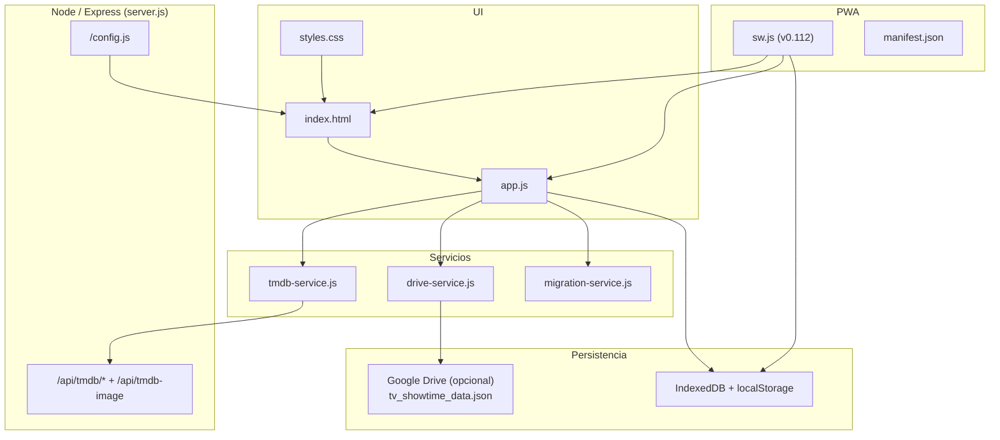

# Manual técnico de SeenIt

Documentación en español para **mantener** la app sin depender de un asistente y para **aprender** cómo está diseñada (PWA vanilla, servidor Express/proxy TMDB, sync opcional en Google Drive, IndexedDB, notificaciones locales y migración universal).

La guía de instalación rápida y configuración inicial siguen en el [README raíz](../README.md). Aquí está el “por qué” y el “dónde tocar”.

---

## Cómo leer este manual

### Si empiezas de cero
1. [01 — Visión y arquitectura](01-vision-y-arquitectura.md)
2. [02 — Modelo de datos](02-modelo-de-datos.md)
3. [06 — Navegación y layout](06-navegacion-y-layout.md)
4. [17 — Glosario](17-glosario.md)

### Si vas a cambiar comportamiento
1. El doc de la feature (07–12)
2. [15 — Decisiones](15-decisiones-y-historial.md) (contexto del *por qué*)
3. [16 — Guía de mantenimiento](16-guia-mantenimiento.md) (checklist práctico)

### Si algo de sync / login falla
1. [03 — Persistencia y sync](03-persistencia-y-sync.md)
2. [05 — Drive OAuth](05-drive-oauth.md)
3. [16 — Mantenimiento](16-guia-mantenimiento.md) → sección debug

---

## Mapa mental

---

## Índice

| # | Documento | Tema |
|---|-----------|------|
| 01 | [Visión y arquitectura](01-vision-y-arquitectura.md) | Qué es, capas, servidor Express, scripts, `AppState` |
| 02 | [Modelo de datos](02-modelo-de-datos.md) | Movie, Show, List, Selector, Preferencias, Gamificación, tombstones |
| 03 | [Persistencia y sync](03-persistencia-y-sync.md) | IndexedDB, localStorage, LWW, debounce, modo local sin Drive |
| 04 | [TMDB](04-tmdb.md) | Proxy `/api/tmdb`, endpoints, normalización, caché IDB, providers |
| 05 | [Drive OAuth](05-drive-oauth.md) | GIS, token, alcance `drive.file`, find/create/save JSON |
| 06 | [Navegación y layout](06-navegacion-y-layout.md) | 5 tabs, subnavs, scroll, sticky chrome, modales, desplegables |
| 07 | [Timeline series](07-timeline-series.md) | Pending/upcoming, minicalendario, ancla, continue vs stale |
| 08 | [Películas y filtros](08-peliculas-y-filtros.md) | Chips multi-selección, suscripciones, duración, ordenar, azar |
| 09 | [Perfil, listas, favoritos y logros](09-perfil-listas-favoritos.md) | Biblioteca, listas, selector «¿Qué vemos?», logros, Wrapped |
| 10 | [Ficha detalle](10-ficha-detalle.md) | Hero, tráiler, nota, crítica, episodios saltados, menú |
| 11 | [Import / export y migración](11-import-export-tvtime.md) | `migration-service.js`: SeenIt, SeriesGuide, Trakt, Letterboxd, IMDb, TV Time, CSV |
| 12 | [PWA / Service Worker](12-pwa-service-worker.md) | Caché `v0.112`, notificaciones PWA locales/segundo plano, banner update |
| 13 | [UI / CSS](13-ui-css-convenciones.md) | Variables `--tvst-*`, temas desbloqueables, sticky, componentes |
| 14 | [API global `window`](14-api-global-window.md) | `window.App`, `SeenItMigration`, handlers onclick |
| 15 | [Decisiones e historial](15-decisiones-y-historial.md) | Producto / técnica |
| 16 | [Guía de mantenimiento](16-guia-mantenimiento.md) | Features, SW, sync, deploy, traps |
| 17 | [Glosario](17-glosario.md) | LWW, tombstone, flatrate, continueBoost, Selector, Wrapped… |

---

## Criterios de esta documentación

- Cita archivos reales (`server.js`, `app.js`, `migration-service.js`, `drive-service.js`, `tmdb-service.js`, `sw.js`, `index.html`, `styles.css`).
- No incluye secrets ni credenciales reales.
- Si el código y un doc discrepan, **gana el código**; actualiza el doc.
